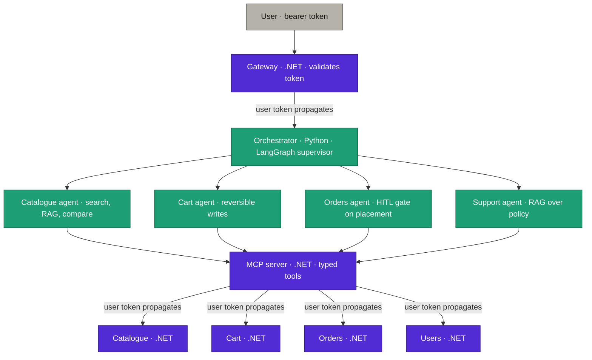

# Project state

Paste this into any new AI session, or hand it to a colleague, and they are current in one
message. It is a briefing, not documentation — kept short on purpose.

## What this is

An enterprise **.NET reference implementation** showing how an *existing* .NET application
gains **multi-agent AI orchestration without being rewritten**. The .NET services stay as
they are and expose typed tools through an MCP server; a Python (LangGraph) supervisor
orchestrates four specialist agents over them. Built as the **.NET CoE reference at
HCLTech**, reviewed **mid-January 2027**. The audience is engineers inside and outside the
company who will adopt it for their own projects — so clone-and-run and honest security are
the point, not a flashy demo.

## The architecture in one diagram

The **user's identity propagates** along every edge labelled *user token propagates* — from
the gateway, through the orchestrator and MCP server, into each service, which enforces
user-level access control itself. The **HITL gate** sits at the Orders agent: order
placement is *proposed*, never committed, until the user confirms.

## The six use cases

1. **Product discovery with RAG** — natural-language search grounded in product specifications.
2. **Order history** — *the identity case*: a user sees only their own orders, enforced downstream.
3. **Cart assembly** — stateful, reversible writes across a conversation.
4. **Order placement behind the HITL gate** — the agent proposes a structured order; nothing commits until approved.
5. **Policy questions** — RAG over a *second* corpus (policy documents), routed to the Support agent.
6. **Ambiguous multi-domain request** — forces the supervisor to decompose across agents.

Plus the **four negative cases** (D10), built and demonstrated deliberately: prompt
injection via retrieved content · cross-user access attempt · runaway tool loop ·
hallucinated action rejected by schema validation.

## Current status

| Component | Status | Notes |
|---|---|---|
| Azure platform (Terraform/Terragrunt, AKS, Argo CD) | 🔴 Not started | Adapt from the earlier AntKart repo |
| Environment lifecycle pipelines (up/down/stop/start) | 🔴 Not started | Project-prefix input (D8) |
| Five .NET services (Gateway, Users, Catalogue, Cart, Orders) | 🔴 Not started | System of record |
| Identity (Entra app reg, workload identity, propagation) | 🔴 Not started | The central security demo (D5) |
| Retrieval (ingestion, embeddings, Azure AI Search, identity filtering) | 🔴 Not started | Two corpora |
| MCP server (.NET, typed tools) | 🔴 Not started | The runtime boundary (D2) |
| Python orchestrator (LangGraph supervisor + 4 agents) | 🔴 Not started | Supervisor pattern (D1) |
| HITL gate + bounded autonomy | 🔴 Not started | D6, D7 |
| Negative cases | 🔴 Not started | D10 — first-class |
| Observability, evaluation, cost | 🔴 Not started | One trace across both runtimes |
| Documentation + articles | 🔴 Not started | Phases 5–6 |

## Constraints

- **Azure OpenAI on a personal account, no company sponsorship** — cost discipline is real.
  Use **gpt-4o-mini** for development. **Stop AKS and PostgreSQL between sessions**; a
  stopped **PostgreSQL Flexible Server auto-starts after 7 days**, so set a reminder if it
  stays down.
- Roughly **2–3 hours on weekdays**, more at weekends, alongside a full-time project.
- **Christmas to New Year leave is the largest available block** — plan the heaviest work there.
- **Review mid-January 2027** — the fixed deadline.

## What reusable assets exist

**Terraform and Terragrunt modules, the Helm chart, the Argo CD setup, and the GitHub
Actions workflows** can be **adapted from the earlier AntKart repository** rather than
written from scratch — renamed and parameterised by project prefix (D8). This is where most
of Phase 0–1 time is saved.

## How to work on this

- Read **[BACKLOG.md](BACKLOG.md)** for the current item — one in progress at a time.
- **Update status at the end of a session, not during** — the session is for building.
- The plan **is expected to change** as the build teaches things. **Rewrite it** rather than
  force the build to match a stale plan; log what moved in BACKLOG's *Changed plan* section.
- Decisions in **[DECISIONS.md](DECISIONS.md)** are locked — don't re-litigate them mid-build;
  supersede with a dated entry if one genuinely has to change.
